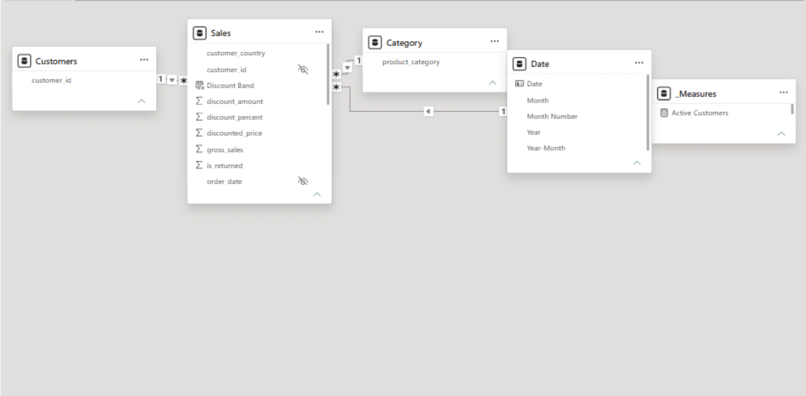
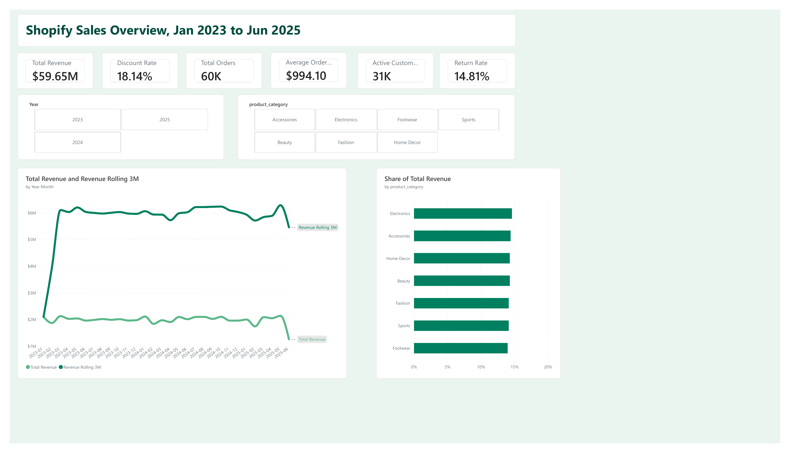

# Shopify Sales Analytics in Power BI (Star Schema + DAX)

A Power BI report built on a star-schema model with DAX measures, rebuilding the analysis from my earlier Shopify Sales & Customer Analytics project (SQL, Python, Tableau).

**Data:** 60,000 orders, 31,154 customers, 1 Jan 2023 to 18 Jun 2025 (the dataset from my earlier project). **Tools:** Power BI Desktop, Power Query, DAX. Python was used only to validate the results.

## Model
`Sales` (fact) with `Customers`, `Category` and a marked `Date` table, all one-to-many with single-direction filtering. Measures sit in a dedicated `_Measures` table.

## Data preparation (Power Query)
- Set data types, trimmed text columns, checked `order_id` for duplicates (none).
- Added `gross_sales` and `discount_amount`.
- Built `Customers` and `Category` dimensions with Reference queries.
- Data-quality finding: `revenue` equals `discounted_price x quantity` on every row, but about 16,000 customers appear with more than one country and about 7,000 product IDs appear with more than one category and price. Country, price and product ID are therefore not stable attributes of a customer or product, so I kept them on the fact table rather than forcing them into dimensions.

## Report pages
1. **Overview:** revenue, orders, AOV and return rate, monthly revenue with a rolling 3-month line, share of revenue by category.
2. **Customers:** repeat customer rate, revenue concentration, revenue by traffic source, top customers.
3. **Returns & Discounts:** return rate and discount rate, return rate by discount band and by category.

## Key DAX
Full list with explanations: [DAX_measures.md](DAX_measures.md). Highlights: `SAMEPERIODLASTYEAR`, `TOTALYTD`, `DATESINPERIOD` (rolling 3 months), `RANKX` with `SUMX` for customer concentration, `CALCULATE` with `ALL`/`ALLSELECTED`, and `SWITCH` for discount bands.

## Findings
- Revenue was 59.65M across 60,000 orders (average order value 994.10).
- **57.2%** of customers placed more than one order.
- The top 27% of customers by spend generate **55.6%** of revenue. (In my earlier SQL project, the RFM "Champion" segment, 27% of customers, generated about 52% of revenue. These are two different definitions.)
- Return rate is **14.8%**, and it is flat across discount levels (14.1% with no discount, 14.9% at 5-10%, 14.8% at 15-20%, 15.0% at 25%+). This supports my earlier finding that discounting does not drive returns (r = 0.0065).
- Revenue is spread evenly across the seven categories.

## Validation
Every measure was checked against an independent Python calculation on the source CSV. One discrepancy was found and fixed: with `DENSE` ranking, tied customer revenues let 8,555 customers into the "top 27%" (56.23%); switching to `SKIP` ranking gave exactly 8,412 customers and 55.61%, matching Python.

## Limitations
- Built in Power BI Desktop only; not published to Power BI Service, so there is no scheduled refresh or row-level security.
- 2025 is a partial year (to 18 June), so full-year 2025 comparisons are not like for like. Year-to-date versus prior-year-to-date is the fair comparison.
- The dataset is from my earlier project, so the new work here is the model, DAX and report.

- The source `profit` column is about 98.6% of revenue (profit 58.83M vs revenue 59.65M), which is not a realistic margin, so I did not build any margin analysis on it.

## Next steps
Publish to Power BI Service, add scheduled refresh and row-level security, and add a customer retention (cohort) page.
